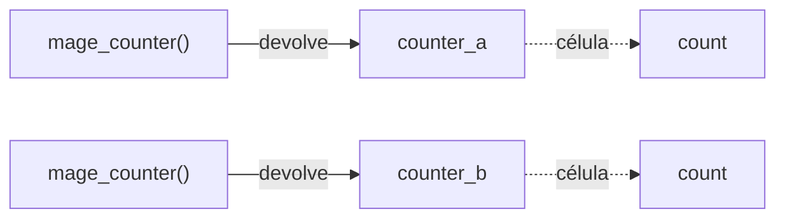

# mage_counter

Crie o arquivo `ex2/scope_mysteries.py` com o `import` e a primeira função. As páginas seguintes
acrescentam as outras três e a demonstração, sempre no fim do arquivo.

```python
from collections.abc import Callable
from typing import Any


def mage_counter() -> Callable:
    count = 0

    def counter() -> int:
        nonlocal count
        count += 1
        return count

    return counter
```

`Any` (de `typing`, "qualquer tipo") é usado mais adiante, em
[memory_vault](./05-memory-vault.md).

É o contador de [Escopo e closures](../02-conceitos/04-escopo-e-closures.md#nonlocal), com a
assinatura do enunciado:

- `count = 0` é uma variável local de `mage_counter`. Cada chamada de `mage_counter()` cria um
  `count` novo;
- `counter` aumenta e devolve a contagem. `nonlocal count` faz o `count += 1` mudar a variável de
  `mage_counter`, e não criar uma local nova (sem ele, a chamada lança `UnboundLocalError`);
- `return counter` devolve a função. Ela leva o `count` junto, numa célula da closure, e a
  contagem persiste entre as chamadas;
- a primeira chamada devolve 1, porque o `count += 1` acontece antes do `return`.

Dois contadores criados com duas chamadas de `mage_counter()` têm cada um a sua célula, e por isso
contam de forma independente:


