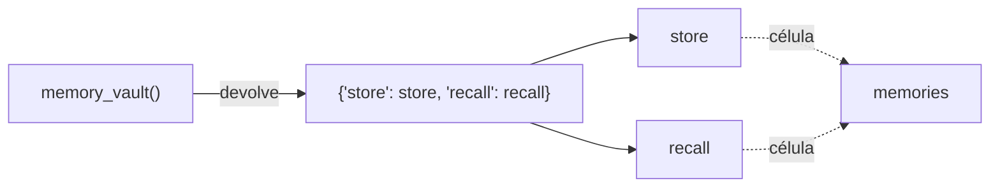

# memory_vault

O cofre de memórias tem duas operações, guardar e recuperar, e as duas precisam enxergar o mesmo
dicionário, sem que ninguém mais o enxergue. A solução são duas funções criadas na mesma chamada,
que compartilham a mesma variável envolvente. A função entra depois de `enchantment_factory`:

```python
def memory_vault() -> dict[str, Callable]:
    memories: dict[str, Any] = {}

    def store(key: str, value: Any) -> None:
        memories[key] = value

    def recall(key: str) -> Any:
        return memories.get(key, "Memory not found")

    return {"store": store, "recall": recall}
```

- `memories` é o dicionário das memórias. A anotação `dict[str, Any]` diz que as chaves são texto
  e os valores podem ser de qualquer tipo (o enunciado guarda um número, `42`); é necessária
  porque o dicionário começa vazio e o mypy não saberia o tipo;
- `store(key, value)` grava o valor na chave. Gravar uma chave muda o **conteúdo** do dicionário,
  sem atribuir um valor novo ao nome `memories`, e por isso não precisa de `nonlocal`
  ([Mudar um objeto não precisa de nonlocal](../02-conceitos/04-escopo-e-closures.md#mudar-um-objeto-não-precisa-de-nonlocal));
- `recall(key)` usa `get`, o método de dicionário que devolve o valor da chave ou, se a chave não
  existe, o segundo argumento: `"Memory not found"`. O retorno é `Any`: um valor guardado ou o
  texto;
- o `return` devolve as duas funções num dicionário, com as chaves `'store'` e `'recall'` que o
  enunciado pede.

## Por que a memória é privada

`memories` não é devolvido: só as duas funções são. Quem recebe o cofre só consegue guardar e
recuperar por elas; nenhuma variável do programa leva direto ao dicionário (só a inspeção da
closure, com `__closure__`, chegaria nele). As duas funções
apontam para a **mesma** célula, porque foram criadas na mesma chamada de `memory_vault`; um
segundo cofre, criado por outra chamada, tem o seu próprio dicionário.


