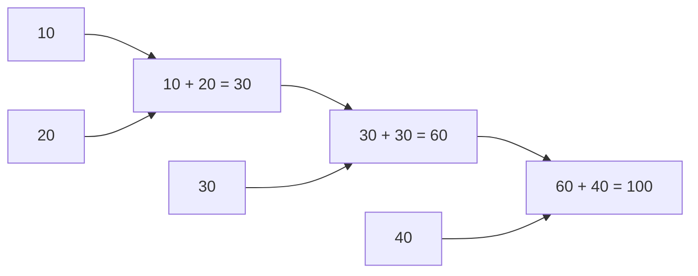

# spell_reducer

Somar, multiplicar, achar o maior: todas são a mesma ideia, combinar uma lista inteira num valor
só, aplicando uma operação de dois em dois. `functools.reduce` faz exatamente isso, para qualquer
operação de dois argumentos.

## reduce

`reduce(função, lista)` pega os dois primeiros itens e aplica a função; depois aplica a função ao
resultado e ao terceiro item, e assim até o fim. Crie `experimentos/reduzir.py`, com uma soma que
mostra cada passo:

```python title="experimentos/reduzir.py"
from functools import reduce


def add_and_show(total: int, power: int) -> int:
    print(f"{total} + {power} = {total + power}")
    return total + power


print(reduce(add_and_show, [10, 20, 30, 40]))
print(reduce(add_and_show, [10]))
print(reduce(add_and_show, [], 0))
try:
    reduce(add_and_show, [])
except TypeError as error:
    print(f"TypeError: {error}")
```

```bash
python3 experimentos/reduzir.py
```

```text
10 + 20 = 30
30 + 30 = 60
60 + 40 = 100
100
10
0
TypeError: reduce() of empty iterable with no initial value
```



- com quatro itens, a função roda três vezes, e o resultado de cada passo vira o primeiro
  argumento do passo seguinte;
- com um item só, `reduce` devolve o item sem chamar a função;
- com a lista vazia, não há o que combinar: `reduce` lança `TypeError` ("`reduce()` de um
  iterável vazio sem valor inicial"), a não ser que receba um terceiro argumento, o **valor
  inicial**, devolvido nesse caso.

## O módulo operator

O módulo `operator` tem os operadores do Python em forma de função: `operator.add(2, 3)` é
`2 + 3`, e `operator.mul(2, 3)` é `2 * 3`. Assim, um operador pode ser passado para `reduce` sem
escrever uma função ou uma lambda. Para maior e menor, o `operator` não tem função; as funções
embutidas `max` e `min` servem, porque `max(a, b)` devolve o maior dos dois.

## A função

A função entra no começo do arquivo `ex3/functools_artifacts.py`, logo depois dos `import`.
Crie o arquivo com este começo; as páginas seguintes acrescentam o resto, sempre no fim:

```python
import functools
import operator
from collections.abc import Callable
from typing import Any


def spell_reducer(spells: list[int], operation: str) -> int:
    operations: dict[str, Callable[[int, int], int]] = {
        "add": operator.add,
        "multiply": operator.mul,
        "max": max,
        "min": min,
    }
    if operation not in operations:
        raise ValueError(f"Unknown operation: {operation}")
    if not spells:
        return 0
    return functools.reduce(operations[operation], spells)
```

- o dicionário `operations` liga cada nome de operação do enunciado a uma função de dois
  argumentos. O type hint `Callable[[int, int], int]` diz isso: recebe dois `int` e devolve um
  `int`. Escolher a função por um dicionário evita uma fila de `if`/`elif`;
- **operação desconhecida:** o enunciado pede que o erro seja tratado de forma adequada. Aqui,
  "tratar o erro" é recusar a operação com uma mensagem clara (`ValueError`) e deixar o `except`
  para quem chama, como mostra o teste de
  [Rodar e conferir](./08-rodar-e-conferir.md#spell_reducer). A
  função lança `ValueError` com uma mensagem que diz qual operação não existe, e quem chama decide
  o que fazer com ela ([Rodar e conferir](./08-rodar-e-conferir.md)). A assinatura promete um
  `int`, e devolver um texto de erro quebraria essa promessa. Lançar `ValueError` é escolha do
  tutorial;
- a operação é conferida antes da lista: uma operação inexistente é um erro mesmo com a lista
  vazia (escolha do tutorial);
- **lista vazia:** devolve 0, como o enunciado pede, antes de chegar ao `reduce`, que lançaria
  `TypeError`;
- `functools.reduce(operations[operation], spells)` combina a lista com a função escolhida.
  `Any` é usado mais adiante, em [spell_dispatcher](./05-spell-dispatcher.md).

Com `[10, 20, 30, 40]`: `"add"` dá 100, `"multiply"` dá 10 × 20 × 30 × 40 = 240000, `"max"` dá 40
e `"min"` dá 10.
