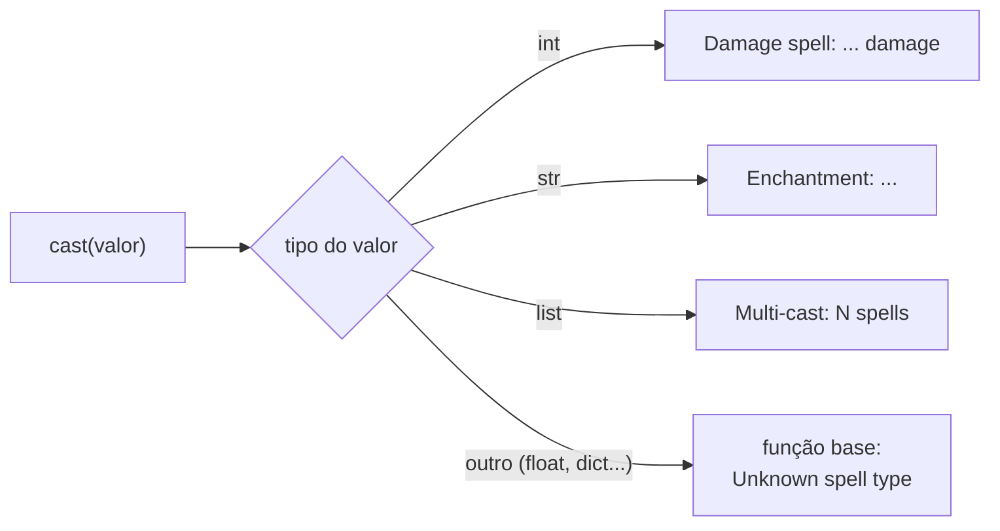

# spell_dispatcher

Um feitiço pode chegar como um número (dano), um texto (encantamento) ou uma lista (vários
feitiços). Uma função que trata os três precisaria de uma fila de `if isinstance(...)`, e cada tipo
novo exigiria mexer nela. `functools.singledispatch` troca a fila por funções separadas, uma por
tipo, e escolhe sozinho qual rodar pelo tipo do primeiro argumento: o **despacho único** (*single
dispatch*).

## A função

`spell_dispatcher` entra depois de `memoized_fibonacci`:

```python
def spell_dispatcher() -> Callable[[Any], str]:
    @functools.singledispatch
    def cast(spell: Any) -> str:
        return "Unknown spell type"

    @cast.register
    def _(spell: int) -> str:
        return f"Damage spell: {spell} damage"

    @cast.register
    def _(spell: str) -> str:
        return f"Enchantment: {spell}"

    @cast.register
    def _(spell: list) -> str:
        return f"Multi-cast: {len(spell)} spells"

    return cast
```

- **a função base:** `@functools.singledispatch` transforma `cast` numa função de despacho. O corpo
  dela roda quando nenhum tipo registrado combina com o argumento: é o caso "tipo de feitiço
  desconhecido" do enunciado. O parâmetro é `Any`, como o enunciado pede;
- **os registros:** `@cast.register` registra uma versão de `cast` para o tipo anotado no primeiro
  parâmetro. `spell: int` registra a versão para inteiros, `spell: str` para textos, e
  `spell: list` para listas;
- **o nome `_`:** as versões registradas não são chamadas pelo nome; o caminho até elas é sempre
  `cast`. `_` é o nome de costume para "um nome que não será usado", e pode se repetir sem aviso
  do flake8 nem do mypy;
- **`list` sem colchetes:** o `register` usa a anotação para saber o tipo, e só aceita classes. Um
  type hint como `list[str]` não é uma classe, e o `register` lança `TypeError` ao ver um;
- **as mensagens** saem da saída do enunciado: `Damage spell: 42 damage`, `Enchantment: fireball`,
  `Multi-cast: 3 spells` (`len` conta os itens da lista) e `Unknown spell type`.

`spell_dispatcher` cria e devolve a função de despacho, como uma fábrica: cada chamada monta uma
`cast` nova, com os seus registros.

## Como o despacho escolhe



O despacho segue a herança das classes: um valor de uma classe filha de um tipo registrado usa a
versão daquele tipo. É o caso do `bool`, que no Python é filho de `int`: `cast(True)` cai na versão
de `int` ([Rodar e conferir](./08-rodar-e-conferir.md)).
