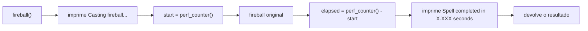

# spell_timer

Crie o arquivo `ex4/decorator_mastery.py` com os `import` e o primeiro decorador. As páginas
seguintes acrescentam o resto, sempre no fim do arquivo.

```python
import time
from collections.abc import Callable
from functools import wraps
from typing import Any


def spell_timer(func: Callable) -> Callable:
    @wraps(func)
    def wrapper(*args: Any, **kwargs: Any) -> Any:
        print(f"Casting {func.__name__}...")
        start = time.perf_counter()
        result = func(*args, **kwargs)
        elapsed = time.perf_counter() - start
        print(f"Spell completed in {elapsed:.3f} seconds")
        return result

    return wrapper
```

## Os import

- `time` é o módulo da biblioteca padrão para medir e esperar tempo. O enunciado sugere o
  `time.sleep` dele, e a regra geral libera módulos da biblioteca padrão quando o exercício
  precisa;
- `wraps` é o único item do `functools` liberado neste exercício, por isso o `import` traz só
  ele: `from functools import wraps`;
- `Callable` e `Any` são type hints, de `collections.abc` e de `typing`.

## O decorador

É o formato de duas camadas de [Decoradores](../02-conceitos/06-decoradores.md): `spell_timer`
recebe a função e devolve o `wrapper`.

- `print(f"Casting {func.__name__}...")`: o nome da função decorada, lido de `__name__`. Para um
  feitiço chamado `fireball`, imprime `Casting fireball...`;
- `time.perf_counter()` devolve um instante, em segundos, de um relógio feito para medir
  intervalos curtos com precisão. O número sozinho não quer dizer nada; a diferença entre dois
  instantes é o tempo que passou. `time.time()`, a hora do relógio do sistema, também mediria,
  mas pode pular se o relógio for ajustado no meio da medição;
- `result = func(*args, **kwargs)` roda a função original com os argumentos recebidos, e o
  resultado é guardado para ser devolvido no fim, como o enunciado pede;
- `{elapsed:.3f}` formata o número com três casas decimais: depois dos dois-pontos, dentro das
  chaves da f-string, vem o **formato**; `.3f` quer dizer "número com ponto, três casas". `0.1043`
  vira `0.104`;
- `@wraps(func)` copia o nome e a docstring da função original para o `wrapper`
  ([functools.wraps](../02-conceitos/06-decoradores.md#functoolswraps)).


